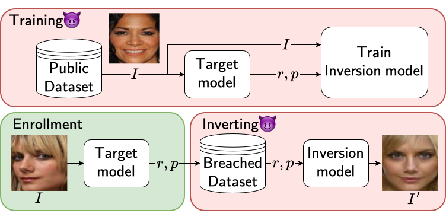

# Embedding Security

Artifact for the paper ["Model Inversion meets Cryptographic Fuzzy Extractors"](https://arxiv.org/pdf/2510.25687). It includes the PIPE model inversion attack against various FE schemes on face embeddings, and the secure Snapper-FE scheme as a defense against model inversion. 

<p align="center">
    <a href="https://arxiv.org/pdf/2510.25687"></a>
</p>

Overview of the PIPE attack pipeline. The attacker first
trains an inversion model using images from a public dataset
and their protected embeddings obtained by querying the target
model. At inversion time, the attacker attempts to invert a protected
embedding r and helper p extracted from the breached dataset to
obtain an image I′ that is similar to the enrollment image I.

## Setup

This code has been tested on Ubuntu 22.04 LTS with NVIDIA DRIVER 595.58.03, CUDA 13.2 in conda environments listed in `./envs`.

### Repository Setup


Several scripts resolve repository paths via the `PROJECT_ROOT` environment variable, loaded from a `.env` file at the repo root. After cloning, update it to point at your local checkout.
```bash
sed -i "s|^PROJECT_ROOT=.*|PROJECT_ROOT=$(pwd)|" .env   # run from the repo root
```

The following command sets up all necessary environments
```bash
cd Embedding-Security
bash envs/build_envs.sh
```

The `facialfe_leech*` schemes use the [`leech-decoding`](https://github.com/avanpo/leech-decoding) git submodule. After cloning, initialize it with 
```bash 
git submodule update --init leech-decoding
``` 
Its small C decoder is compiled automatically on first use (a C compiler `gcc` must be available); see [PIPE_attack/README.md](./PIPE_attack/README.md#datasets) for details.

### Files Setup
You can directly download the preprocessed images, protected embeddings, trained models and computed results by running the following command :
```bash 
bash download_all.sh
```
This pulls from four sources (~30GB total) and places each piece where the attack/metric code reads it:

| Source | Contents | Download |
| --- | --- | ---: |
| Kaggle `snapperfe-preprocessed-dataset` | preprocessed images + protected embeddings (`datasets/pp`) | ~2.4GB |
| Kaggle `snapperfe-pipe-attack` | PIPE attack datasets, models, results (`PIPE_attack/`) | ~21.8GB |
| Kaggle `snapperfe-prior-work` | Bob attack datasets/models/results + GAN attack models (`Bob_attack/`, `GAN_attacks/`) | ~4.5GB |
| Google Drive | GAN attack reconstructed images (`GAN_attacks/{GMI,DMI}/attack_res`) | ~0.6GB |

You may choose to download a subset instead by commenting out a section in `download_all.sh`, depending on your disk space and bandwidth.

## Datasets
`download_all.sh` downloads all relevant (preprocessed) datasets. In our paper, we use Celeb-A, LFW and CASIA-Webface.
To instead regenerate the preprocessed images and Facenet512 embeddings from the raw datasets and see the expected directory layout, see [datagen/README.md](./datagen/README.md).

## Attack results

The artifact covers three reconstruction attacks on the **facialfe** fuzzy-extractor family
(`facialfe_leech`, `facialfe_leech_randomised`, `facialfe_e8`), our defense **ourfe**, and an
`unprotected` baseline; the folder `PIPE_attack` additionally covers the **randomfe** construction
for computing TPR, FPR. All embeddings use the Facenet512 model.

To see the threshold computation and FPR, TPR rate for Facenet512, run notebook [PIPE_attack/datagen/get_unprotected_thresholds_celeba.ipynb](PIPE_attack/datagen/get_unprotected_thresholds_celeba.ipynb).

### PIPE Attack

To observe ASR values, see [PIPE_attack/ASR.ipynb](./PIPE_attack/ASR.ipynb). Recovered-secret entropy per scheme is in [PIPE_attack/datagen/entropy_results/RESULTS.md](./PIPE_attack/datagen/entropy_results/RESULTS.md).

Please see [PIPE_attack/README.md](PIPE_attack/README.md) for more details


### Bob Attack

To observe ASR values, see [Bob_attack/experiments/ASR.ipynb](./Bob_attack/experiments/ASR.ipynb)

Please see [Bob_attack/README.md](Bob_attack/README.md) for more details

### GAN Attacks

To observe ASR values, see the aggregated table in [GAN_attacks/RESULTS_SUMMARY.md](./GAN_attacks/RESULTS_SUMMARY.md).

Please see [GAN_attacks/README.md](GAN_attacks/README.md) for more details

### Majority Voting (ourfe defense)

To see how the **ourfe** (Snapper-FE) defense behaves under majority voting — enrolling a person multiple times (each enrollment using a different key) and authenticating with a single CelebA image, observing the resulting TPR/FPR — run [majority_voting/majority_voting_ourfe.ipynb](./majority_voting/majority_voting_ourfe.ipynb). It writes the [majority_voting/majority_voting_ourfe_tpr.png](majority_voting/majority_voting_ourfe_tpr.png) and [majority_voting/majority_voting_ourfe_fpr.png](majority_voting/majority_voting_ourfe_fpr.png) plots.

### LPIPS and FID Results
To get the LPIPS and FID scores for the PIPE, GAN and Bob attack reconstructed images, run
```bash
cd metrics
bash metrics.sh > metrics_results.log
```
The generated results can be seen in the file `metrics/metrics_results.log` (LPIPS values are also written to [metrics/lpips_results.csv](metrics/lpips_results.csv), and FID values to [metrics/fid_results.csv](metrics/fid_results.csv)). Note that the computed values might show minor deviation from the reported values due to differences in hardware. The GAN reconstruction images are downloaded by `download_all.sh` (into `GAN_attacks/{GMI,DMI}/attack_res`); they can also be regenerated from scratch via the GAN pipeline (`GAN_attacks/scripts/run_all.sh`).